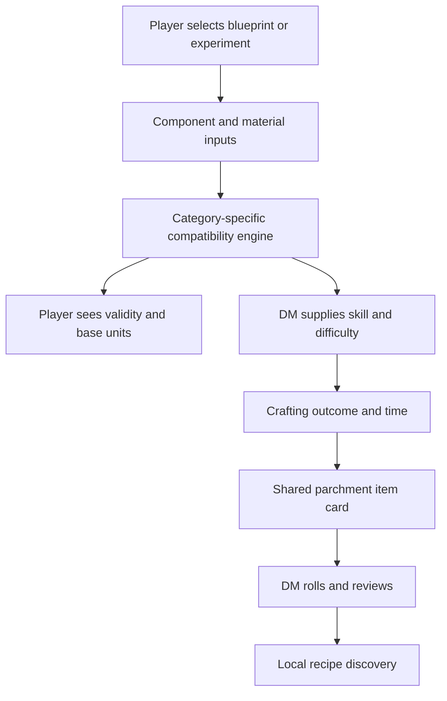

# GuildenHeim — System Documentation

**Version:** 0.9.1  
**Project:** Procedural crafting and recipe-discovery workbench for a D&D 5e (2014) campaign  
**Platform:** Static website, compatible with GitHub Pages  
**Audience:** Players, Dungeon Masters, playtesters, and developers  
**Status:** Beta / homebrew prototype

> **Rules boundary:** GuildenHeim is an unofficial homebrew crafting tool, not an implementation of the entire 2014 D&D ruleset. Standard weapon and armor entries use 2014 equipment statistics as reference values. Component calculations, success odds, material units, crafting XP, time tiers, discoveries, and procedural recommendations are campaign rules requiring DM approval.

## 1. Overview

GuildenHeim allows a player to start with a standard equipment recipe or experiment with a custom combination of materials and components. The player can evaluate basic construction viability and estimated material usage. A DM can unlock review tools, choose crafting difficulty and proficiency, calculate a provisional result, roll an attempt, and save a successful discovery for future use.

The main design goals are:

1. **Familiar foundation:** Recognizable 2014 equipment serves as the baseline.
2. **Modular design:** Players select parts and materials rather than choosing only a finished item.
3. **Discovery:** Unconventional combinations become candidates for new recipes.
4. **DM authority:** Generated statistics and interaction effects are recommendations, not automatic rulings.
5. **Campaign growth:** Locally saved prototypes can become established or mastered recipes through DM review.

### Available crafting categories

| Category | Beta status | Reference content |
|---|---|---|
| Melee | Functional | 28 standard 2014 melee weapon blueprints |
| Ranged | Functional | 9 standard 2014 ranged weapon blueprints |
| Armor | Functional | 12 standard armor types and 1 shield |
| Magic | Placeholder | No functional generator or magic-item database yet |

**Total:** 50 standard equipment blueprints. A blueprint is not the same as a unique procedurally generated recipe.

## 2. Player Guide

### Choose a recipe

1. Open the website and select **Melee**, **Ranged**, or **Armor** from the top navigation.
2. Select a standard blueprint from the sidebar.
3. Read the component choices, then customize materials, shapes, construction, or workmanship.
4. Observe the **construction validity** and **base material estimate**.
5. Add design notes explaining the intended construction or unusual effect.
6. Select **Export design** (Melee) or **Export player design** (Ranged/Armor) to download a JSON proposal for the DM.

### Experiment instead of using a known recipe

- Use **Experiment** / **Design a new weapon** in Melee.
- Use **Experiment with ranged parts** in Ranged.
- Use **Experiment with armor** in Armor.
- Choose the desired parts, check compatibility, and document the idea.

### What the player can see

The public interface shows component options, materials, design notes, construction status, and **base** material units before proficiency reductions. It does **not** provide the DM's final success chance, crafting-time adjustment, or approved custom-item combat statistics.

### Construction status

| Status | Meaning |
|---|---|
| Valid | Passes the current simplified component checks; crafting success is not guaranteed |
| Conditional | Plausible but requires reinforcement, adaptation, or a DM ruling |
| Invalid | A required connection or material combination is unsupported; correct it before attempting |

**Important:** A *valid* experimental design is not necessarily a balanced 2014 D&D item.

## 3. Dungeon Master Guide

### Enter DM review

1. Select **DM review** in the site header.
2. Enter the configured convenience code. The default in v0.9.1 is `test123`.
3. Select the equipment category and build to evaluate.
4. Choose the **Crafter skill level** and **DM difficulty**.
5. For Armor, optionally provide a wearer's **Dexterity modifier** for a sample AC calculation.
6. Select **Generate DM result**.
7. Review the parchment card, compatibility reasoning, physical profile, material units, crafting time, and success chance.
8. Use **Attempt crafting / discovery** to roll the attempt.
9. Following success, save a discovery when appropriate; approve later recipe progression separately.

**Access limitation:** The code is stored in browser-delivered JavaScript. It is **not secure authentication**. Do not publish secrets, private campaign notes, or personal data expecting the DM view to protect them.

### Crafter skill levels

| Level | Name |
|---|---|
| 0 | Untrained |
| 1 | Apprentice |
| 2 | Journeyman |
| 3 | Skilled |
| 4 | Expert |
| 5 | Master |

Higher levels generally reduce adjusted material units, increase crafting success chances, and reduce time. The current material-cost rule applies an approximate **5% reduction per skill level**, rounded up per material type. Melee also tracks optional named-crafter XP locally; that XP system should not be confused with official D&D character experience or proficiency bonus.

### DM difficulty choices

| Choice | Internal adjustment |
|---|---:|
| Easy | -1 |
| Standard | 0 |
| Hard | +1 |
| Extreme | +2 |

Difficulty contributes to the homebrew crafting calculation. The exact formulas and category-specific exceptions are in `js/engine.js`, `js/ranged.js`, and `js/armor.js`.

### Success rolls

GuildenHeim resolves a craft attempt with **1d100** against the displayed percentage. A roll at or below the chance succeeds. The DM result also provides a rounded **d20 alternative** in 5% increments. The d100 roll is the exact representation of the displayed percentage.

Failed attempts do not automatically consume material units; the DM makes that decision. There is **no player inventory or automatic material deduction**.

### Discovery progression

1. A successful experimental craft can be saved as a **Prototype**.
2. The DM can advance a saved recipe to **Established**.
3. The DM can later advance it to **Mastered**.

The progression is saved in the browser for the current equipment category. Mastered recipes receive provisional reliability/time benefits under the homebrew formulas. These stages do not automatically grant new damage dice, AC, magic effects, or other combat bonuses. A modified recipe may need to be evaluated again before its progression benefits apply.

### Interaction discoveries (Melee)

The melee engine emits descriptive tags from the selected materials, shape, head, handle, and technique. `data/interactions.js` contains rules that match sets of required tags. Matching an interaction only creates a **candidate**. The DM must approve it before treating it as an established campaign discovery. Candidate effect text does not execute as code or directly change combat statistics.

## 4. Equipment Systems

### 4.1 Melee

**Inputs:** Blade/head form, head material, head size, shape, handle form, handle material, handle size, mounting method, pommel, workmanship, and optional crafting technique.

**Assessment:** Structural connection, material integrity, leverage and handling, provisional physical mass/length, and the nearest standard weapon blueprint.

**Output:** A parchment item card with name, category, damage, damage type, weapon properties, a 2014 market price/weight reference when the standard blueprint matches, description, and DM ruling. Experimental property suggestions are not guaranteed.

### 4.2 Ranged

**Inputs:** Frame (bow, crossbow, blowgun tube, sling, thrown projectile, or net), main material, launch mechanism, grip/stock, and workmanship.

**Assessment:** Frame-to-mechanism compatibility, permitted materials, compact-build conditions, and homebrew mass, length, integrity, and handling scores.

**Output:** The shared parchment card plus ammunition and normal/long range, with provisional markers for changed builds. A standard bow or crossbow retains its normal 2014 ammunition, loading, and weapon-property references.

### 4.3 Armor and shields

**Inputs:** Protective shell, main material, lining, fasteners, reinforcement, and workmanship.

**Assessment:** Material compatibility, special construction concerns, material-unit requirements, and homebrew mass, coverage, integrity, and mobility scores.

**Output:** The shared parchment card plus 2014 baseline AC, Strength requirement, stealth effect, don/doff times, market price and weight. Changed armor designs show baseline AC as a **reference**, not an automatically earned value.

#### 2014 AC handling

| Equipment | AC treatment |
|---|---|
| Light armor | Base AC + full Dexterity modifier |
| Medium armor | Base AC + Dexterity modifier, maximum +2 |
| Heavy armor | Fixed AC, ignoring Dexterity (including negative modifiers) |
| Shield | +2 AC added to worn armor or other applicable AC calculation |

Certain heavy armor entries impose a Strength requirement and may reduce walking speed when the requirement is not met. Stealth penalties remain those of the chosen standard equipment. **Workmanship and material ratings never automatically increase AC.**

### 4.4 Magic (planned)

The Magic tab is currently a placeholder. The existing material database contains an abstract `magic` rating used by some procedural references, but the website **does not** implement an official magic-item catalog, spellcasting system, attunement rules, rarity pricing, or magical crafting procedures.

## 5. Materials and Economy

GuildenHeim uses **abstract material units**, not official gold-piece manufacturing costs or a player inventory.

- **Material catalog:** `data/materials.js`
- **Material properties:** Mass multiplier, structural integrity, hardness, toughness, flexibility, magical affinity, and workability.
- **Baseline construction usage:** Derived from chosen parts, size, optional additions, and techniques.
- **Skill reduction:** Adjusts DM-facing material requirements.
- **2014 market price:** A separate equipment reference; it is **not** the amount of crafting material units consumed.

The currently defined materials include steel, iron, mithral, adamantine, oak, ash, bone, leather, cloth, and rawhide. These property ratings are homebrew values, not official 2014 material stat blocks.

## 6. Crafting Time

The shared timing function is `calculateCraftingTime()` in `js/crafting-time.js`.

| Tier | Baseline | Example use |
|---|---|---|
| Tiny | 6 seconds, one turn | Assembling prepared small projectile components |
| Small | 60 seconds, ten rounds | Minor assembly from prepared parts |
| Medium | 2 hours | Standard sword, shortbow, leather armor, or shield |
| Large | 12 hours | Large weapons or medium/heavy equipment components |
| Massive | 24 hours | Complete plate, chain mail, or splint constructions |

**Conceptual formula:**

```text
adjusted time = baseline tier time
              × (1 + 0.18 × complexity)
              × (1 - 0.10 × crafter skill)
              × (0.90 if mastered, otherwise 1.00)
```

Results are rounded to whole six-second increments, floored at six seconds, and capped at 24 hours per attempt. The individual category engine determines the relevant size tier and complexity before calling this shared function. For a turn-scale task, assume the needed pieces are **already prepared**; refining ore, treating hide, making parts, or acquiring a workshop may require additional time determined by the DM.

**Game terminology note:** In 2014 5e combat, a round is approximately six seconds and contains the participants' turns. The website uses “1 turn” to label its shortest tier and “rounds” for multi-round tasks; it does not mean a character can forge an entire raw-metal weapon in six seconds.

## 7. Data Flow and Architecture



### Source organization

```text
index.html
css/
  styles.css          Common theme and layout
  categories.css      Top navigation and placeholder pages
  player.css          Player-facing controls
  dm.css              DM visibility rules
  skill.css           Crafting skill presentation
  ranged.css          Ranged layout
  armor.css           Armor-specific layout
  item-card.css       Shared parchment styling
data/
  materials.js        Material types and ratings
  components.js       Melee component definitions
  recipes.js          28 melee standard blueprints
  weapon-stats.js     2014 weapon price and weight reference
  ranged.js           Ranged parts and nine blueprints
  armor.js            Armor parts and thirteen blueprints
  properties.js       2014 weapon-property glossary
  techniques.js       Melee crafting techniques
  interactions.js     Tag-based melee interaction candidates
js/
  storage.js          Local save keys and shared helpers
  crafting-time.js    Tiered time calculations
  engine.js           Melee rules, materials and classification
  item-card.js        Shared equipment card renderer
  app.js              Main interface, melee, DM tools, import/export
  ranged.js           Ranged interface and outcomes
  armor.js            Armor interface and outcomes
tests/
  smoke.js            Basic data, AC, timing and compatibility checks
```

The scripts are ordinary deferred JavaScript, loaded in dependency order by `index.html`. There is no required build step, package installation, framework, server runtime, or SQL database for the static website.

## 8. Persistence, Export, and Import

### Browser storage

The app uses `localStorage` to retain discoveries and selected campaign configuration in the **current browser**. Important keys include:

| Key | Purpose |
|---|---|
| `forgebook_discoveries_v1` | Historical melee discovery storage key (kept for compatibility) |
| `guildenheim_ranged_discoveries_v1` | Ranged discoveries |
| `guildenheim_armor_discoveries_v1` | Armor discoveries |
| `guildenheim_material_attributes_v1` | DM-edited material ratings |
| `guildenheim_crafter_xp_v1` | Named crafter XP |
| `guildenheim_craft_history_v1` | Repeated crafting activity |
| `guildenheim_approved_interactions_v1` | Approved melee interactions |

**Local means local:** Player A's browser and the DM's browser do not automatically share saved data. Clearing browser/site storage may remove discoveries. Export regularly.

### Player proposal files

- Melee exports `guildenheim-player-design.json`.
- Ranged exports `guildenheim-ranged-player-design.json`.
- Armor exports `guildenheim-armor-player-design.json`.

The proposal includes components and design notes, with additional non-sensitive estimate information where supported. It is not a finalized DM ruling.

### DM backups

Use **Export recipes** to download the combined GuildenHeim JSON backup of melee, ranged, and armor discoveries. Use **Import** to restore a compatible backup or review a player proposal. Imported discoveries are validated and may be treated as provisional pending DM approval. Do not assume that every local preference or campaign setting is included in the discovery backup.

## 9. GitHub Pages Deployment

1. Extract the `guildenheim-v0.9.1-complete.zip` package.
2. Open its `guildenheim-v091` directory.
3. Upload the **contents** of that directory into your GitHub repository root (the repository root should directly contain `index.html`).
4. Keep `css/`, `data/`, `js/`, and `tests/` directories intact.
5. In repository **Settings → Pages**, choose deployment from the `main` branch and root directory.
6. After the deployment finishes, open your Pages URL and hard-refresh (`Ctrl+Shift+R`) if scripts appear outdated.

### Security and hosting boundaries

- GitHub Pages serves static files; it does **not** run a Node server or securely validate the DM passcode.
- JavaScript must be enabled to calculate and export designs.
- `localStorage` is browser-local, not a shared multiplayer database.
- Do not put passwords, API secrets, private campaign notes, or sensitive player data into public repository scripts.
- The site imports user-provided JSON; avoid trusting unreviewed saved designs as approved campaign content.

## 10. Developer Maintenance

### Routine editing map

| Change | Main file |
|---|---|
| Add/edit materials | `data/materials.js` (name and ratings must be consistent) |
| Add melee components | `data/components.js` |
| Add melee recipes | `data/recipes.js` |
| Add ranged parts/recipes | `data/ranged.js` |
| Add armor parts/recipes | `data/armor.js` |
| Adjust compatibility and probabilities | `js/engine.js`, `js/ranged.js`, `js/armor.js` |
| Adjust time tiers | `js/crafting-time.js` |
| Update shared parchment content | `js/item-card.js` |
| Adjust parchment appearance | `css/styles.css`, `css/item-card.css` |
| Modify navigation and exports | `js/app.js` |
| Adjust discovery interactions | `data/interactions.js` |
| Change DM access code | `js/storage.js` (not secure) |

### Compatibility and migration advice

Keep existing recipe IDs and storage keys stable where possible. If you add a new material, define it consistently before exposing it in an item recipe. Version 0.9.1 includes a fallback for leather, cloth, and rawhide when older cached material data is loaded. The HTML uses versioned script URLs for certain critical assets to mitigate cache mismatches. Always upload all changed dependencies together.

### Testing

From a Codespaces terminal or local Node.js environment:

```bash
node tests/smoke.js
```

The smoke test verifies the expected recipe counts, standard component compatibility, selected AC calculations, timing tiers, and the older armor-material-catalog regression.

It **does not** prove every browser workflow works. Before releases, manually check:

- [ ] All four navigation tabs open without console errors.
- [ ] All 28 melee recipes can be selected.
- [ ] All 9 ranged recipes can be selected.
- [ ] All 13 armor/shield recipes can be selected.
- [ ] Valid, conditional, and invalid combinations display appropriately.
- [ ] Player design notes and JSON exports work in all three functional categories.
- [ ] DM review can generate a result in each category.
- [ ] Success rolls and save buttons work.
- [ ] Discovery stage advancement requires DM confirmation.
- [ ] Importing player designs and recipe backups works.
- [ ] Exiting DM mode hides DM-only results.
- [ ] Mobile layouts are usable and text remains legible.
- [ ] Reloading the page preserves local saves in the same browser.

**Known gap:** Automated end-to-end browser testing is not currently included. For a production-ready release, add integration tests for tab transitions, input validation, import/export, and saved discovery state.

## 11. Beta Test Plan

### Suggested 30–45 minute session

1. **5 minutes — orientation:** Explain the player/DM split, abstract units, and experimentation premise.
2. **10 minutes — familiar equipment:** Ask each player to craft a standard melee, ranged, or armor blueprint.
3. **10–15 minutes — experimentation:** Ask players to design something unconventional without coaching them on individual clicks.
4. **5–10 minutes — DM resolution:** Process proposals, resolve several rolls, and save one discovery.
5. **5 minutes — feedback:** Ask what was fun, confusing, too expensive, or missing.

### Recommended observations

| Metric | Record |
|---|---|
| Number of players | Count participants |
| First-craft completion time | Minutes per player |
| Standard vs experimental designs | Counts for each |
| Valid, conditional, and invalid attempts | Counts for each |
| Craft successes and failures | Counts for each |
| DM interventions | Each time the DM has to explain a mechanic |
| Software issues | Error message, steps to reproduce, browser/device |
| Requested features | Item types or mechanics players tried to use |

### Feedback questions

1. Could you understand how to make your first item without help?
2. Did different parts or materials offer meaningful choices?
3. Did crafting time and material requirements feel appropriate?
4. Was experimentation worth doing compared with standard recipes?
5. Did any rule or control feel unfair, confusing, or unnecessarily slow?
6. What item would you try to make next?

### Example issue report

```text
Issue ID:
Category/tab:
Browser and device:
Selected blueprint:
Component choices:
Steps to reproduce:
Expected behavior:
Actual behavior:
Console error (if any):
Severity: blocker / major / minor / cosmetic
```

## 12. Current Limitations and Roadmap

| Priority | Future work | Reason |
|---|---|---|
| High | End-to-end browser tests | Catch initialization, tab, import/export, and state bugs |
| High | Balance playtesting and tuning | Make material/time/skill tradeoffs meaningful |
| High | Shared equipment/outcome schema | Reduce repeated logic across melee, ranged, and armor |
| Medium | More secure DM workflow | Client-side code cannot protect private rulings |
| Medium | Portable campaign saves | Reduce reliance on one browser's local storage |
| Medium | Magic item crafting prototype | Complete the fourth planned category |
| Later | Campaign synchronization | Optional shared data with a backend |
| Later | Richer discovery visualization | Show how an experiment became a standard recipe |

## 13. Portfolio and Case-Study Notes

GuildenHeim demonstrates **game systems design**, **component-based procedural generation**, **rule-driven validation**, **interactive front-end development**, and **iterative balancing**. The strongest portfolio evidence will come from measured beta feedback and specific revisions rather than feature count alone.

When documenting the project publicly, include:

- The design problem and intended player experience.
- A screenshot or short clip of an experiment and DM ruling.
- A concise architecture diagram.
- A concrete example of a generated item and its compatibility assessment.
- The results of real playtesting (participants, observations, issues, and changes).
- Technical limitations and future improvements.

Avoid claiming that the full 2014 D&D rules are implemented, that the DM passcode is secure, or that random procedural outcomes have been balanced through testing unless you have direct evidence.

---

**Reference:** [D&D Beyond — Basic Rules (2014), Equipment](https://www.dndbeyond.com/sources/dnd/basic-rules-2014/equipment). This is a reference source for standard equipment; GuildenHeim's procedural crafting mechanics are unofficial homebrew.
